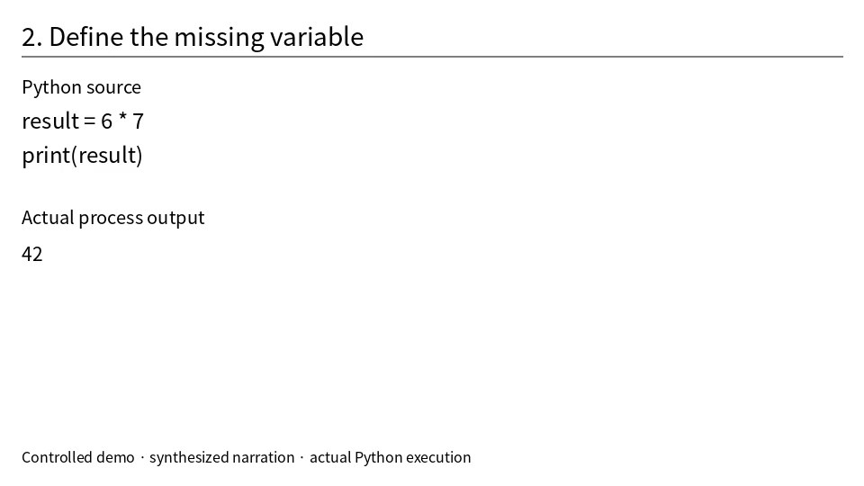

# please-transcribe

**Transcribe what was said. See what was shown.**

Turn presentations, screencasts, demos, and lectures into original-language
transcripts linked to timestamped screen images. Review uncertain speech with
your preferred agent, and export Markdown, plain HTML, PDF, JSON, SRT, or WebVTT.
Run the client and local CPU pipeline on **Linux, Windows, or macOS**. Choose
local inference, a Docker environment, or a configured remote transcription server.

[Read the demo](examples/demo/index.md) · [Download HTML](examples/demo/index.html) ·
[PDF](examples/demo/index.pdf) · [Review queue](examples/demo/review.html) ·
[Demo source and provenance](examples/demo/README.md)



An actual screen image from the demo: the example program defines `result` and
prints `42`. The demo follows a code change from an error to successful execution.

- **Beyond slides:** capture screen changes in code demos, browser walkthroughs,
  slides, and other recordings, plus periodic images for context.
- **Original languages:** English, Korean, Spanish, and other Whisper-supported
  languages; transcription and translation are separate tasks.
- **Keep the original:** immutable ASR text, separate correction proposals,
  explicit review decisions, and audio/image review coverage.
- **Use your own tools:** CLI, Python API, file-based review, and optional MCP.
  Work with Codex, Claude, Antigravity, or another capable harness.
- **Run locally or share a server:** CPU inference, optional Apple Silicon MLX,
  or an authenticated remote ASR endpoint. No paid API is required.
- **Portable outputs:** native HTML elements and extracted images, without CSS
  or JavaScript. Resume interrupted work and process batches independently.

This is an early release. Visual changes are pixel-based candidates, not semantic
understanding. ASR can omit or misrecognize speech. Review helps investigate these
errors; it does not guarantee a complete or accurate transcript.

## Quick start: local transcription

Prefer to let an agent install it? Copy a setup request from
[install with Codex, Claude Code, or another agent](docs/INSTALLATION.md#install-with-an-agent).

Requirements: Python 3.10+ and `ffmpeg`/`ffprobe` on `PATH`. Install FFmpeg through
your operating system's package manager or [FFmpeg](https://ffmpeg.org/download.html).
Install from this repository; the package is not currently published to PyPI.

```sh
git clone https://github.com/ts06068/please-transcribe.git
cd please-transcribe
python -m venv .venv
# Linux/macOS:
. .venv/bin/activate
# Windows PowerShell instead:
# .venv\Scripts\Activate.ps1
python -m pip install -e '.[media,cpu]'

please-transcribe doctor
please-transcribe run presentation.mp4 --work work/session --language auto
```

The default local engine is faster-whisper, using `large-v3` on CPU with INT8
computation. First use downloads model weights. Use `--model tiny` for a quick
functionality check; evaluate accuracy on your own media before choosing a model.
The executable `avtimeline` remains an alias; the Python package is `avtimeline`.

Results appear in `work/session/exports/`. Repeat the same command to reuse verified
stages or resume unfinished work. Choose a new session directory for a different
recording or changed extraction/ASR options.

```sh
please-transcribe run korean.mp4 --work work/korean --language ko
please-transcribe run spanish.mp4 --work work/spanish --language es
please-transcribe run mixed.mp4 --work work/mixed --multilingual
```

`--multilingual` detects language per decoding window with faster-whisper. The
MLX adapter supports automatic or explicit language per recording, without this
per-window option. Rapid switching within a window may still be inaccurate.

## Use an existing server

Install the lightweight client with `python -m pip install -e '.[media]'` and
install FFmpeg. Get an endpoint and your own API key from the server administrator:

```sh
please-transcribe connect --endpoint https://transcribe.example.org
# Enter your key at the hidden prompt.
please-transcribe doctor
please-transcribe run presentation.mp4 --work work/session
```

With a connection profile, remote transcription becomes the default. Audio goes
to the configured server; screen extraction and exports stay on the client.
If that server is unavailable, the client reports the error and retains its job
receipt. It does not silently load a local model.

## Choose a deployment

| Mode | Where it runs | Setup |
| --- | --- | --- |
| Local CPU | Linux, Windows, macOS | Install the media and CPU extras; run faster-whisper locally. |
| Docker CPU | A host with a compatible Docker runtime | Use the provided Dockerfile and Compose configuration. |
| Remote client | Linux, Windows, macOS, development containers | Connect to an existing ASR endpoint; no local ASR weights are needed. |
| Optional MLX acceleration | Apple Silicon macOS | Use the MLX adapter; this is one optional backend. |

The client, evidence timeline, review protocol, and output formats are independent
of the inference host. GPU engines need their own compatible hardware and runtime.
The bundled `server install` provisioning adapter currently targets macOS; this
limitation applies to that installer, not to the project as a whole. On other
platforms, use the local/Docker CPU pipeline or connect to an existing endpoint.

For administrators, the [installation guide](docs/INSTALLATION.md) explains the
supported server provisioning path, per-user keys, Docker control, and lifecycle.
Additional clients only install the client and connect. Use a trusted private
connection or HTTPS for audio and credentials; routing and TLS are managed by
the administrator.

## Use through an agent

Open this repository in an agent with file and terminal access, then ask:

> Read AGENTS.md. Process `/path/to/presentation.mp4` with please-transcribe,
> preserving every recognized utterance in its original language. Inspect the
> screen evidence and record corrections and uncertainties separately from the
> original transcript. Export Markdown and plain HTML. Report which audio and
> images you actually inspected and provide the output paths.

`run` creates review packets; it does not perform an LLM review itself. Your
agent follows the generated review schema and imports its report. Review can use
your existing harness; the project does not read account tokens or bundle vendor
CLI wrappers. A text-only or image-only agent must report its modality limits.

See the [agent guide](docs/AGENT_GUIDE.md), [operating instructions](AGENTS.md), and
[Python/MCP setup](docs/WORKFLOWS.md#python-and-mcp).

## Docker client

Build a portable client with media tools, URL intake, MCP, VAD dependencies, and
optional PDF support. ASR model weights are not included in the image.

```sh
docker build -f Dockerfile.client --build-arg WITH_PDF=1 -t please-transcribe-client .
docker run --rm -it -v "$PWD:/work" please-transcribe-client --help
```

For shared-server use, mount your private connection profile separately. See the
[container client example](docs/INSTALLATION.md#container-client-alternative).
For local CPU inference, `docker compose build` and `docker compose run --rm
avtimeline run /work/recording.mp4 --work /work/session` use the provided CPU
configuration. Place recordings in the host `work/` directory first. Add
`--build-arg WITH_PDF=1` to the Compose build for PDF support.

## Investigate and export

```sh
please-transcribe review focus --work work/session
please-transcribe inspect context --work work/session --start 60 --end 75
please-transcribe inspect audio --work work/session --start 60 --end 70
please-transcribe inspect frames --work work/session --start 62 --end 65 --interval 0.25
please-transcribe review status --work work/session
please-transcribe export --work work/session --output work/session/exports \
  --formats md,html,pdf,json,srt,vtt
```

| Format | Output | Sharing notes |
| --- | --- | --- |
| Markdown | `index.md` + images | Keep companion image folders together. |
| HTML | `index.html` | Standalone, embedded images, no CSS/JavaScript. |
| PDF | `index.pdf` | Prints the plain HTML with Chromium's default layout. |
| JSON | `transcript.json` + images | Original speech, word times, observations, links, reviews. |
| SRT | `transcript.srt` | Original ASR text; proposals do not replace subtitles. |
| WebVTT | `transcript.vtt` | Original ASR text. |

PDF is optional: install `python -m pip install -e '.[pdf]'`, run
`python -m playwright install chromium`, and install fonts covering your languages.
On Linux, Chromium may also need `python -m playwright install-deps chromium`.

For URL input, batches, VAD omission auditing, progress events, review decisions,
source relocation, and MCP, see [workflows](docs/WORKFLOWS.md). Pixel changes are
sampled; tune the interval and thresholds for your recordings. Existing A/V timing
is preserved, including stream offsets and variable frame rate. The program does
not repair pre-existing audio delay or clock drift.

## Documentation and development

- [Installation and shared serving](docs/INSTALLATION.md)
- [Workflows, CLI examples, Python API, and MCP](docs/WORKFLOWS.md)
- [Natural-language agent guide](docs/AGENT_GUIDE.md)
- [Agent operating instructions](AGENTS.md)
- [Release scope](docs/ROADMAP.md) and [verification record](docs/VERIFICATION.md)
- [Contributing](CONTRIBUTING.md) and [security](SECURITY.md)

```sh
python -m unittest discover -s tests -v
python scripts/check_demo.py
```

Core tests require no model downloads. Media tests need FFmpeg and the media
extra; MCP/URL tests need their respective extras. Set `AVTIMELINE_TEST_PDF=1`
with Chromium installed to exercise PDF generation. CI covers a Linux/macOS/Windows
core matrix, media integration, and Docker builds. See the verification record
for checks actually executed; configured workflows alone do not prove support.

Repository code is [MIT licensed](LICENSE). Dependencies and model weights retain
their own licenses. Recordings and work directories stay out of Git by default;
the checked-in demo is a controlled synthetic example with documented provenance.
