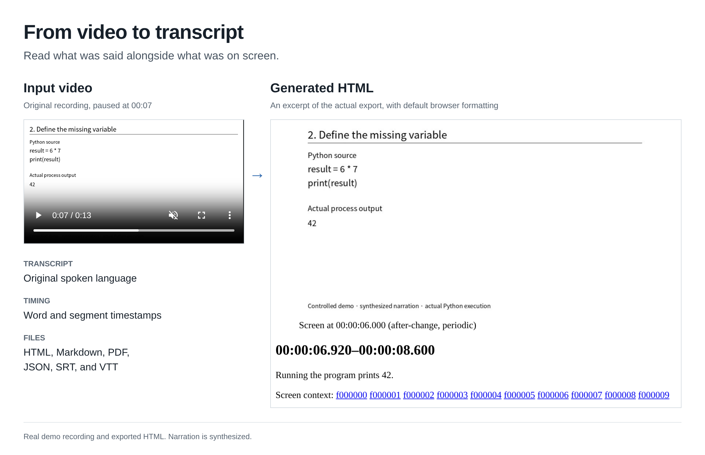

# please-transcribe

Transcribe videos in their original language and match the speech with screenshots.

[](https://github.com/ts06068/please-transcribe/actions/workflows/checks.yaml)
[](pyproject.toml)
[](LICENSE)

[Demo](#demo) · [Features](#key-features) · [Installation](#how-to-use) ·
[MCP](#use-with-mcp) · [YouTube](#youtube) · [Models](#transcription-specification) · [Documentation](#documentation-and-development) ·
[License](#license)

## Demo

[Read the transcript](examples/demo/index.md) · [HTML](examples/demo/index.html) ·
[PDF](examples/demo/index.pdf) · [Review uncertain speech](examples/demo/review.html)

[](examples/demo/index.md)

Left: the input video. Right: the actual HTML output with speech, timestamps,
and a matching screenshot. The [demo recording](examples/demo/README.md) uses synthesized narration.

## Key features

- Transcribe lectures, presentations, and screen recordings.
- Keep English, Korean, Spanish, and other supported languages as spoken.
- Link speech to screenshots taken around screen changes.
- Export Markdown, plain HTML, PDF, JSON, SRT, and WebVTT.
- Resume interrupted work or process several videos at once.
- Read recordings from mounted Google Drive or OneDrive folders.
- Review through MCP or your agent's terminal; keep suggestions separate from the original transcript.
- Run locally on Linux, Windows, or macOS, in Docker, or through a shared server.

Speech recognition can miss or mishear words. Review important passages before relying on them.

## How to use

Install [FFmpeg](https://ffmpeg.org/download.html), then clone the project.
You need Git and Python 3.10 or later.

```sh
git clone https://github.com/ts06068/please-transcribe.git
cd please-transcribe
python -m venv .venv

# Linux/macOS:
. .venv/bin/activate
# Windows PowerShell instead:
# .venv\Scripts\Activate.ps1

python -m pip install -e '.[media,cpu,url]'
please-transcribe doctor --backend faster-whisper
please-transcribe run video.mp4 --work work/session --backend faster-whisper
```

The first run downloads the model. Original files are saved in `work/session/exports/`;
automatically polished files go in `exports/polished/` after agent review.
Repeat the command to resume; use a new folder for another recording.

PDF needs [extra setup](docs/WORKFLOWS.md#export-formats).
For Docker or a shared server, follow the [installation guide](docs/INSTALLATION.md).

### Install with an agent

Open the repository in Codex, Claude Code, or another agent with terminal access and ask:

> Read AGENTS.md and docs/INSTALLATION.md. Install please-transcribe for local CPU
> use in a virtual environment, install the required media tools, and run doctor.

See [installation prompts](docs/INSTALLATION.md#install-with-an-agent) for shared servers and other setups.

## Use with MCP

After the installation above, add the MCP extra:

```sh
python -m pip install -e '.[mcp]'
```

Register this stdio server in your MCP client's settings, using absolute paths:

```json
{
  "command": "/path/to/please-transcribe/.venv/bin/please-transcribe",
  "args": ["mcp", "--root", "/path/to/please-transcribe/work"]
}
```

On Windows, use `.venv\Scripts\please-transcribe.exe` as the executable path.
The surrounding settings format depends on your client.

Ask your agent to run the transcription, then call `polish_session` to inspect
unclear speech and `submit_polish` to return its review. Corrections and exports
are applied automatically. See [MCP setup](docs/WORKFLOWS.md#python-and-mcp).

### Automatic polishing

`run` includes polishing by default. Codex, Claude Code, or another active agent
continues through the review without manual approval commands. Unattended CLI
use needs a [configured harness](docs/POLISH.md#unattended-cli); otherwise it
returns an agent handoff. Use `--polish off` for baseline-only processing.

In the corrected HTML, hover over a marked phrase to see the raw text. PDF uses
yellow highlights with raw-text comments. Originals stay intact; corrected files
are in `exports/polished/`. See [polishing details](docs/POLISH.md).

## YouTube

Give your agent a YouTube link, or run:

```sh
please-transcribe run 'https://www.youtube.com/watch?v=VIDEO_ID' --work work/youtube
```

The video is downloaded automatically and reused on the next run. Local YouTube
intake needs Node.js 22+ or Deno 2.3+; both Docker images include Node.js.
See [URL setup](docs/WORKFLOWS.md#youtube-and-other-urls) for details.

## Cloud recordings

Configure a remote with `rclone config`, then mount it read-only in one terminal:

```sh
please-transcribe cloud mount gdrive:Recordings ~/mnt/recordings
```

In another terminal, pass the mounted video path to `run`. No separate local video
copy is needed; audio, screenshots, and results still use a work directory.
See [Google Drive and OneDrive setup](docs/CLOUD_STORAGE.md) for mount drivers,
Windows examples, and use from a container.

## Transcription specification

The default model is **OpenAI Whisper large-v3** (about 1.55 billion parameters).
For local transcription, use `--model` to choose another compatible model.

| Setting | Default or option |
| --- | --- |
| Local engine | faster-whisper/CTranslate2, CPU, INT8. |
| Optional MLX engine | `mlx-community/whisper-large-v3-mlx`, Apple Silicon, FP16 decoding. |
| Published demo | Remote large-v3, verified OpenAI weights converted to MLX FP16, English. |
| Audio | Mono, 16 kHz, PCM16 WAV. |
| Timing | Segment and word timestamps from the engine. |

Agents use screenshots during review; the initial transcript comes from audio.
The optional speech-detection audit flags possible omissions. HTML uses basic
browser elements and embedded screenshots, with no CSS or JavaScript.

See the [full specification](docs/TRANSCRIPTION.md) for model sources, decoder
settings, timestamps, and what each output records. The automated server installer
currently targets macOS; local CPU use and remote clients support all three platforms.

## Documentation and development

- [Installation](docs/INSTALLATION.md): local, Docker, shared server, and agent setup.
- [Workflows](docs/WORKFLOWS.md): languages, batches, review, Python API, and MCP.
- [Cloud recordings](docs/CLOUD_STORAGE.md): Google Drive and OneDrive mounts.
- [Agent guide](docs/AGENT_GUIDE.md): requests you can give your agent.
- [Contributing](CONTRIBUTING.md): development setup, tests, and commit conventions.
- [Security](SECURITY.md): data handling and reporting vulnerabilities.

## Credits

Built with [Whisper](https://github.com/openai/whisper),
[faster-whisper](https://github.com/SYSTRAN/faster-whisper),
[MLX Whisper](https://github.com/ml-explore/mlx-examples/tree/main/whisper), and
[FFmpeg](https://ffmpeg.org/). README structure follows
[Markdownify](https://github.com/amitmerchant1990/electron-markdownify), listed in
[awesome-readme](https://github.com/matiassingers/awesome-readme).

## License

[MIT](LICENSE). Dependencies and model weights have their own licenses.
