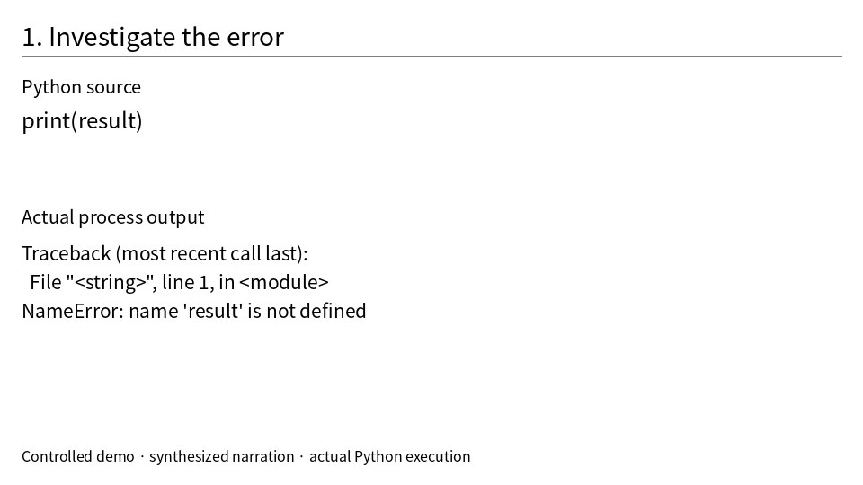
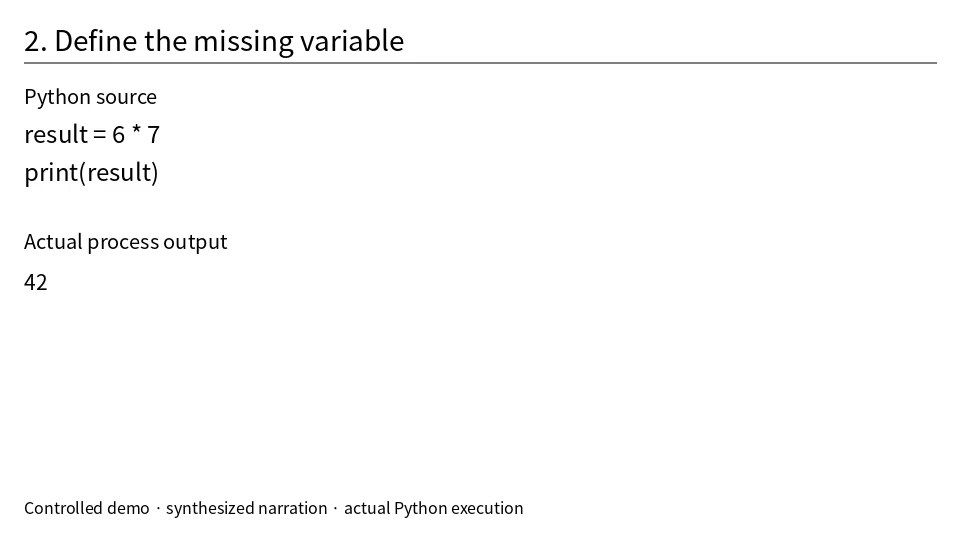
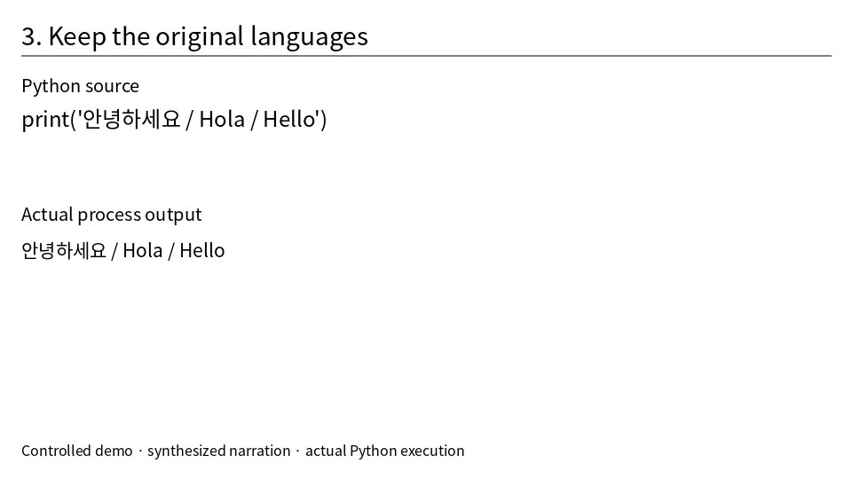

# source\.mp4

Original-language transcript and timestamped screen observations. Visual changes and temporal links are candidates for review.

Source time origin: 0.0 seconds. Displayed times are relative to this origin.

f000000 · 00:00:00.000 · periodic

## 00:00:00.000–00:00:02.940 · s000000

 This Python program prints result before defining it\.

f000001 · 00:00:03.000 · periodic

## 00:00:03.040–00:00:04.780 · s000001

 The traciback shows a name error\.

f000002 · 00:00:05.000 · before\-change

d2f8b2630ab803909-000 · 00:00:05.000 · agent\-requested\-dense\-sample

## 00:00:05.020–00:00:06.700 · s000002

 Na result is 6 times 7\.

d2f8b2630ab803909-001 · 00:00:05.400 · agent\-requested\-dense\-sample

f000003 · 00:00:05.500 · at\-change

Visual change candidate e000000: observed between 00:00:05.000 and 00:00:05.500.

d2f8b2630ab803909-002 · 00:00:05.800 · agent\-requested\-dense\-sample

f000004 · 00:00:06.000 · after\-change, periodic

## 00:00:06.920–00:00:08.600 · s000003

 Running the program prints 42\.

f000005 · 00:00:09.000 · periodic, before\-change

## 00:00:09.040–00:00:13.200 · s000004

 Finally the program prints greetings in Korean, Spanish, and English\.

f000006 · 00:00:09.500 · at\-change

Visual change candidate e000001: observed between 00:00:09.000 and 00:00:09.500.

f000007 · 00:00:10.000 · after\-change

f000008 · 00:00:12.000 · periodic

f000009 · 00:00:13.500 · last\-sample

## Speech coverage audit

Candidates only; coverage does not prove completeness.

- 00:00:13.350–00:00:13.746: possible missing speech

## Review: Demo reviewer: screen inspection only; audio not inspected

Suggestions; original speech is preserved above.

s000001:  The traciback shows a name error\. →  The traceback shows a NameError\.  
Reason: The inspected screen contains Traceback and NameError\. This is a terminology proposal pending audio inspection\.

Decision: deferred by Demo reviewer · Audio was not inspected; preserve the baseline and proposed terminology separately\.

e000000: The screen changes from an undefined result variable and NameError to result = 6 \* 7 with output 42\. (s000002, s000003)

Uncertain s000002: The initial token is transcribed as Na\. Compare the audio before changing it; the screen alone cannot establish the spoken word\.

Explicit review coverage: 2 / 5 speech segments. Coverage is a reviewer attestation, not an accuracy guarantee.
